# MoveIt Task Constructor Pick and Place: UR5e + Inspire RH56DFX Dexterous Hand

<p align="center">
  <a href="docs/media/known_cube_known_place.mp4">
    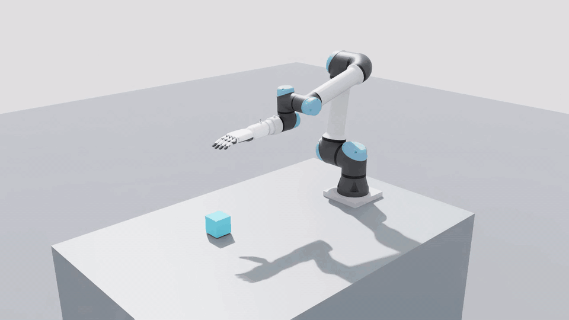
  </a>
  <br/>
  <sub>▶ <a href="docs/media/known_cube_known_place.mp4">full video</a>: NVIDIA Isaac Sim, planned and executed by MoveIt 2 through ros2_control</sub>
</p>

<p align="center">
  <a href="https://github.com/ookkshirsagar/moveit-mtc-pick-and-place/actions/workflows/ci.yml"></a>
  <a href="https://github.com/ookkshirsagar/moveit-mtc-pick-and-place/actions/workflows/benchmark.yml"></a>
  
  
  
  
</p>

A pick-and-place pipeline for a **Universal Robots UR5e** arm fitted with an **Inspire RH56DFX** six-DoF
dexterous hand. The task is planned end to end with **MoveIt Task Constructor (MTC)**: IK, Pilz PTP motion
planning, Cartesian approach and lift, a contact-aware hand closure, attach, place and release. The same
pipeline stacks several cubes, each set down squarely on the one below. It runs on two `ros2_control` backends:

| `hardware:=` | Backend | What you get |
|---|---|---|
| `mock` (default) | `mock_components/GenericSystem` | Kinematic execution in RViz, no simulator needed |
| `isaac` | `topic_based_ros2_control` ↔ NVIDIA Isaac Sim | Full physics: drives, gravity and the cube in a simulated scene |

Either the left or the right hand can be used. All task parameters (positions, distances, speeds) are in
[`config/pick_place.yaml`](ur5e_rh56dfx_manipulation/config/pick_place.yaml).

---

## Scenarios

The cube's position and the place target can each be fixed or chosen at run time. All clips are from
Isaac Sim (click a clip for the MP4); the grid uses the left hand.

<table>
  <tr>
    <th></th>
    <th>Known place</th>
    <th>Random place</th>
  </tr>
  <tr>
    <th>Known cube</th>
    <td><a href="docs/media/known_cube_known_place.mp4"></a></td>
    <td><a href="docs/media/known_cube_random_place.mp4">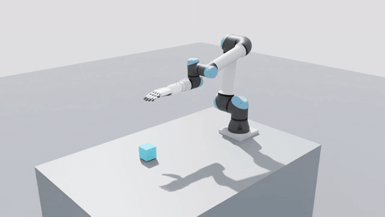</a></td>
  </tr>
  <tr>
    <th>Unknown cube</th>
    <td><a href="docs/media/unknown_cube_known_place.mp4">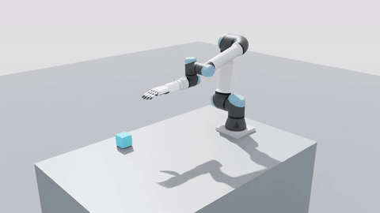</a></td>
    <td><a href="docs/media/unknown_cube_random_place.mp4">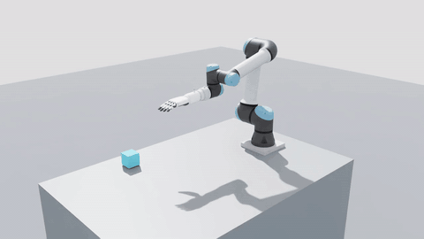</a></td>
  </tr>
</table>

<table>
  <tr>
    <th>Right hand</th>
    <th>Stacking three cubes</th>
  </tr>
  <tr>
    <td><a href="docs/media/right_hand.mp4">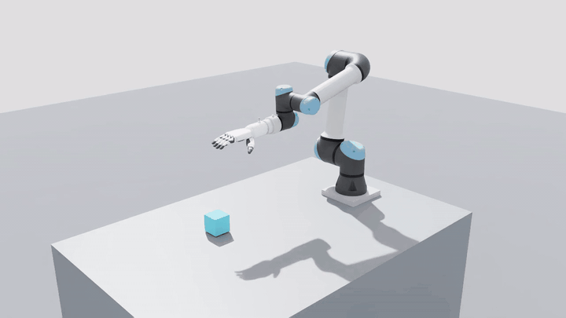</a></td>
    <td><a href="docs/media/stack_three_cubes.mp4">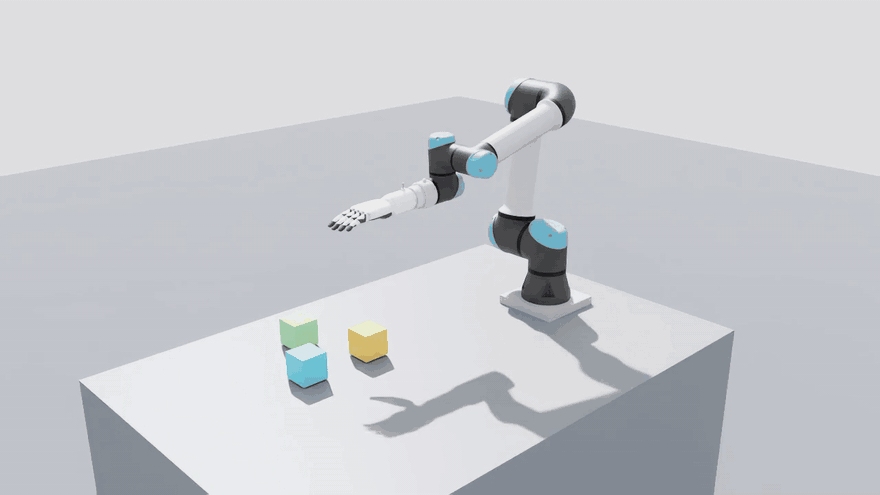</a></td>
  </tr>
</table>

| | How to run it |
|---|---|
| Known cube, known place | defaults: cube at (-0.20, 0.13), placed 15 cm from it along -y |
| Known cube, random place | `place_pose_mode:=random`: a reachable target on the table, sampled each run (`random_seed:=N` repeats one) |
| Unknown cube | `cube_pose_mode:=isaac` with `run_scene.sh --cube random`: Isaac spawns the cube anywhere in the workspace and MTC reads its pose from `/tf`. Combine with either place mode |
| Right hand | `side:=right`, and `run_scene.sh --side right` in Isaac Sim |
| Stacking | `task:=stack`, and `run_scene.sh --task stack` in Isaac Sim: picks every cube in `stack_cube_positions` in turn and stacks them at `stack_position`. In the clip the stack ends up aligned to within 0.1 mm and 0.05° |

"Unknown" means the planner is not told where the cube is; it reads the pose from the simulation at run time.
There is no camera-based perception yet. With mock hardware, `cube_pose_mode:=random` samples the cube
position inside the planning scene instead.

---

## Quick start (mock hardware)

```bash
sudo apt install ros-jazzy-moveit ros-jazzy-moveit-task-constructor-core \
                 ros-jazzy-pilz-industrial-motion-planner ros-jazzy-ur-description \
                 ros-jazzy-ros2-control ros-jazzy-ros2-controllers python3-vcstool

mkdir -p ~/mtc_ws/src && cd ~/mtc_ws/src
git clone https://github.com/ookkshirsagar/moveit-mtc-pick-and-place.git
vcs import < moveit-mtc-pick-and-place/dependencies.repos      # topic_based_ros2_control (for Isaac Sim)
cd .. && colcon build --symlink-install && source install/setup.bash

ros2 launch ur5e_rh56dfx_manipulation mtc_demo.launch.py
```

| Argument | Default | |
|---|---|---|
| `side` | `left` | `left` or `right` hand |
| `task` | `pick_place` | `pick_place`: one cube. `stack`: every cube in `stack_cube_positions`, stacked |
| `hardware` | `mock` | `mock` or `isaac` |
| `cube_pose_mode` | `fixed` | `fixed`: cube at (-0.20, 0.13). `random`: a reachable position sampled each run (mock). `isaac`: the pose Isaac Sim publishes on `/tf` |
| `place_pose_mode` | `fixed` | `fixed`: 15 cm from the cube along -y. `random`: a reachable target on the table, sampled each run |
| `random_seed` | `0` | `0` samples a new pose every run; any other value repeats the same random poses |
| `rviz` | `true` | `false` runs headless |
| `wait_for_enter` | `false` | `true` waits for `ros2 service call /mtc_proceed std_srvs/srv/Trigger` before executing |
| `use_sim_time` | `auto` | `auto` means true for `isaac`, false for `mock` |
| `arm_ns` | `""` | optional namespace, for multi-arm setups |
| `config` | `""` | task parameter file; empty means the installed `config/pick_place.yaml` |

```bash
ros2 launch ur5e_rh56dfx_manipulation mtc_demo.launch.py side:=right cube_pose_mode:=random place_pose_mode:=random
ros2 launch ur5e_rh56dfx_manipulation mtc_demo.launch.py task:=stack
```

### Configuration

[`config/pick_place.yaml`](ur5e_rh56dfx_manipulation/config/pick_place.yaml) holds every tunable, read by
`mtc_node`, `scene_publisher` and the Isaac scene alike:

| Group | Parameters |
|---|---|
| Scene | `table_height`, `cube_size`, `cube_fixed_position`, `cube_random_region`, `place_fixed_offset`, `place_random_region`, `stack_cube_positions`, `stack_position` |
| Motion | `pregrasp_height`, `approach_distance`, `place_clearance`, `grasp_retreat_distance`, `lift_distance`, `place_retreat_distance`, `grasp_settle_time` |
| Speed | `ptp_velocity_scaling`, `ptp_acceleration_scaling`, `lift_velocity_scaling`, `place_velocity_scaling` |
| Planning | `planning_attempts`, `max_solutions` |

Copy it and pass `config:=/path/to/mine.yaml` to change them without rebuilding.

---

## Running in NVIDIA Isaac Sim

Tested with Isaac Sim 6.0 (standalone install). The scene script imports the robot from this repository's
URDF, so no USD asset is needed. It adds a tabletop and a 7.5 cm cube and bridges the joints to ROS 2.

```bash
# terminal 1: Isaac Sim (workspace sourced; ISAAC_SIM defaults to ~/isaacsim)
ISAAC_SIM=~/isaacsim ./src/moveit-mtc-pick-and-place/isaac/run_scene.sh --side left
#   options: --headless  --task stack  --cube -0.25,0.20 | --cube random [--seed N]  --grasp fixed|friction

# terminal 2: MoveIt + MTC, once Isaac prints "start the ROS 2 side now"
ros2 launch ur5e_rh56dfx_manipulation mtc_demo.launch.py hardware:=isaac side:=left
```

Pass `cube_pose_mode:=isaac` to have MTC read the cube's pose from the simulation, for example when you move
it with `--cube` or by hand in the viewport.

### Architecture

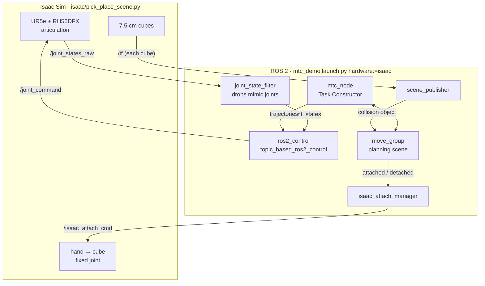

One pick-and-place run, from launch to release:

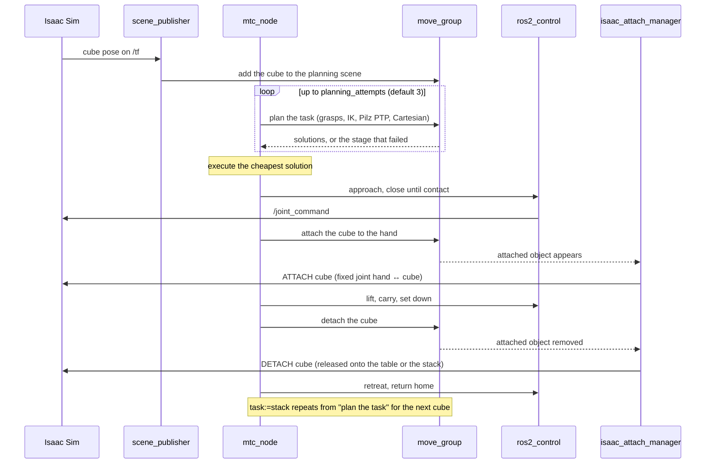

**Physics notes.** The URDF importer writes the hand's `<mimic>` joints for Newton only, so the scene adds
PhysX mimic constraints, finger drive gains and solver settings for the articulation itself. With
`--grasp fixed` (the default) the hand closes onto the cube, stopping at its surface as MoveIt planned, and
the cube is welded to the palm while it is carried. `--grasp friction` holds it by finger contact only. That
mode is experimental, because the gram-scale finger pads make PhysX contact unstable.

---

## The MTC pipeline

`pick_pipeline.cpp` builds the task from primitives in `include/ur5e_rh56dfx_manipulation/motion_primitives/`:

| # | Stage | Planner |
|---|---|---|
| 1 | current state → `home` | Pilz PTP |
| 2 | open the hand | joint interpolation |
| 3 | move to the pregrasp, centred 25 cm above the cube: IK + connect (`move_to_pregrasp.h`) | Pilz PTP |
| 4 | pre-curl the fingers so they clear the cube's top edge | joint interpolation |
| 5 | approach straight down, 16.5 cm | Cartesian |
| 6 | **close until contact**: every finger link stops at the cube's surface (`close_until_contact.h`) | joint interpolation |
| 7 | attach the cube to the hand adapter, retreat and lift 15 cm | Cartesian |
| 8 | move the **cube** to its place pose: IK for the attached cube itself + connect | Pilz PTP |
| 9 | set down, loosen the grip, detach | Cartesian, joint interpolation |
| 10 | retreat up, open the hand in the air, return `home` | Cartesian, Pilz PTP |

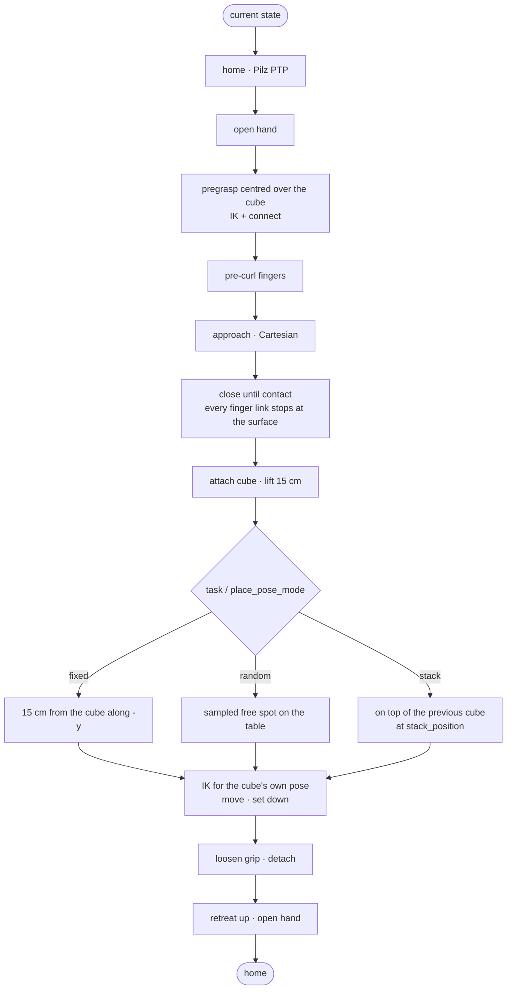

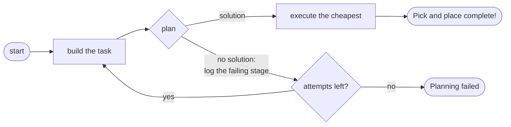

MTC plans several solutions, scores them and executes the cheapest. With `task:=stack` the node runs this
task once per cube, each starting from the scene the previous one left behind.

**Exact placement.** The place target is the pose of the cube, not of the hand: the cube is attached to the
hand adapter (rigidly fixed to the arm flange), so IK can solve for the attached cube's frame directly. Where
the cube sits inside the hand therefore does not matter, and every cube is set down upright, axis-aligned and
centred on its target, which is what keeps a stack straight.

**Centred grasp for either hand.** The pregrasp targets the point midway between the thumb and the fingers.
The right hand is a mirror image of the left across the finger-spread axis, so that point is mirrored too
(15 mm to one side of the adapter axis for the left hand, 15 mm to the other for the right) and both hands
grip the cube on the middle of its faces.

**Contact-aware closing.** Grasping requires hand ↔ object collisions to be allowed, so a plain
`MoveTo("close")` drives the fingers straight through the object. `CloseUntilContact` forbids hand ↔ object
contact again for its own check, on every link a hand joint moves, including the distal phalanges and pads
that hang off mimic joints. It closes the thumb rotation first, then each finger, and the thumb flexion
last, bisecting each joint's closing fraction until its links just touch the cube. So every finger stops at
the cube's surface and the planned grasp is physically consistent.

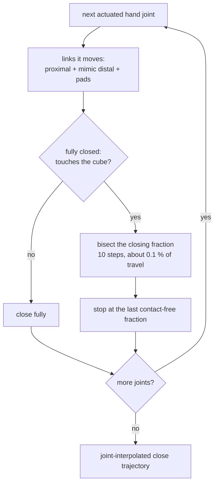

---

## Tests and benchmark

```bash
colcon test --packages-select rh56dfx_description ur5e_rh56dfx_description \
  ur5e_rh56dfx_moveit_config ur5e_rh56dfx_manipulation
colcon test-result --verbose
```

| Test | What it checks |
|---|---|
| `test_close_until_contact` (gtest) | On the real robot model, left and right hand: a cube between the fingertips stops every hand link, distal ones included, at its surface, even with hand ↔ cube contact allowed as in the pipeline |
| `test_placement` (gtest) | Sampled cube and place positions stay in their regions and within reach, seeds reproduce, and the random place region can never overlap the cube region |
| `test_pick_place_mock.py` (launch test) | The full pick and place runs headless on mock hardware and completes |
| flake8, xmllint | Every package |

CI runs them all on every push and pull request.

`tools/benchmark_mock.py` repeats the task over random cube and place poses (one seed per run, so any run can
be reproduced with `random_seed:=N`), or the stacking task with `--task stack`:

| Task (mock hardware, left hand) | Runs | Succeeded | Planning time per cube, median / max | Run time incl. startup, median |
|---|---|---|---|---|
| Pick and place, random cube and place (seeds 1–50) | 50 | 50 (100 %), 2 after a re-plan | 1.2 s / 1.4 s | 28 s |
| Stack three cubes | 5 | 5 (100 %) | 0.9 s / 0.9 s | 72 s |

```bash
python3 src/moveit-mtc-pick-and-place/tools/benchmark_mock.py --runs 50
python3 src/moveit-mtc-pick-and-place/tools/benchmark_mock.py --task stack --runs 5
```

The [nightly benchmark](.github/workflows/benchmark.yml) runs both and fails if fewer than 90 % of the pick
and place runs or any stack run fails. IK is seeded randomly, so `mtc_node` re-plans from scratch if an
attempt finds no solution (`planning_attempts`, default 3). If planning fails, the log names the stage that
failed.

---

## Packages

| Package | Contents |
|---|---|
| `rh56dfx_description` | RH56DFX hand: URDF/xacro, meshes, joint limits, hand-only display |
| `ur5e_rh56dfx_description` | UR5e + RH56DFX on a tabletop, with the flange spacer and the hand mount |
| `ur5e_rh56dfx_moveit_config` | SRDF (left/right), kinematics, OMPL + Pilz pipelines, controllers, `hardware` switch |
| `ur5e_rh56dfx_manipulation` | MTC node and pipeline, motion primitives, scene publisher, Isaac helper nodes |
| `isaac/` | Isaac Sim scene (`pick_place_scene.py`) and its launcher (`run_scene.sh`), not a ROS package |
| `tools/` | `benchmark_mock.py`: success rate and planning time over random poses, or for stacking |

```bash
ros2 launch rh56dfx_description display.launch.py side:=right       # hand only, joint sliders
ros2 launch ur5e_rh56dfx_description display.launch.py side:=left   # arm + hand, joint sliders
ros2 launch ur5e_rh56dfx_moveit_config moveit.launch.py side:=left  # MoveIt MotionPlanning in RViz
```

Planning groups: `arm` (6 UR5e joints) and `hand` (6 actuated RH56DFX joints; the 6 distal joints are mimics).
Named states: `home` (arm), and `open` / `pre_close` / `close` (hand).

---

## Next steps

- Real hardware: the UR ROS 2 driver plus an RH56DFX Modbus driver behind the same controllers
- Perception-driven grasping: camera → 6-DoF object pose → grasp candidates
- Friction-only grasps in Isaac Sim, with tuned pad contact properties

## Citing

If this is useful in your work, GitHub's "Cite this repository" button gives the reference
([CITATION.cff](CITATION.cff)).

## Author

**Omkar Chandrakant Kshirsagar** · [LinkedIn](https://www.linkedin.com/in/ookkshirsagar/) · ookkshirsagar@gmail.com

## License

[Apache 2.0](LICENSE)
