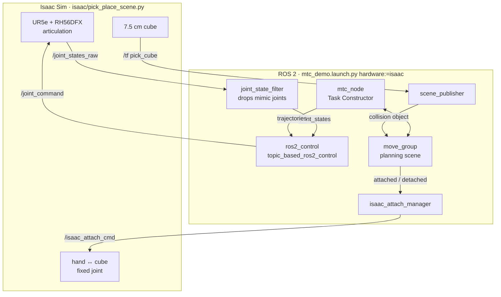
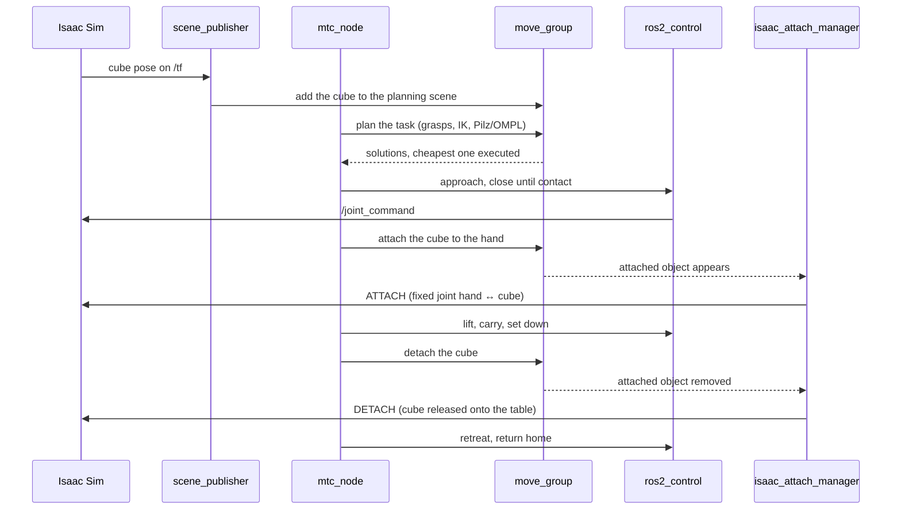
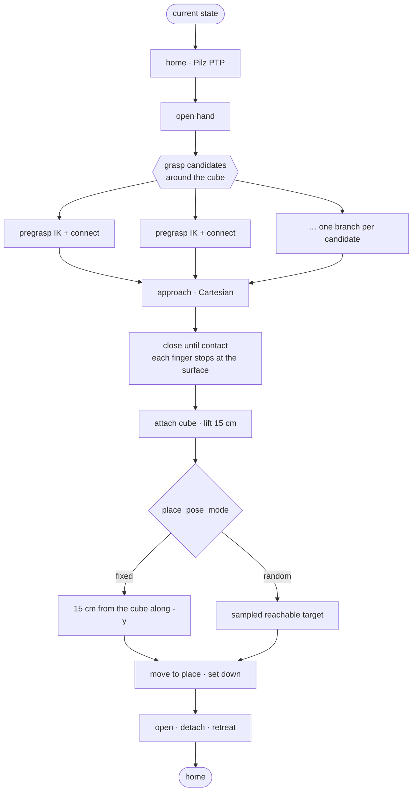

# MoveIt Task Constructor Pick and Place: UR5e + Inspire RH56DFX Dexterous Hand

<p align="center">
  <a href="docs/media/known_cube_known_place.mp4">
    
  </a>
  <br/>
  <sub>▶ <a href="docs/media/known_cube_known_place.mp4">full video</a>: NVIDIA Isaac Sim, planned and executed by MoveIt 2 through ros2_control</sub>
</p>

<p align="center">
  <a href="https://github.com/ookkshirsagar/moveit-mtc-pick-and-place/actions/workflows/ci.yml"></a>
  
  
  
  
</p>

A pick-and-place pipeline for a **Universal Robots UR5e** arm fitted with an **Inspire RH56DFX** six-DoF
dexterous hand. The task is planned end to end with **MoveIt Task Constructor (MTC)**: grasp sampling, IK,
Pilz/OMPL motion planning, Cartesian approach and lift, a contact-aware hand closure, attach, place and release.
The same task runs on two `ros2_control` backends:

| `hardware:=` | Backend | What you get |
|---|---|---|
| `mock` (default) | `mock_components/GenericSystem` | Kinematic execution in RViz, no simulator needed |
| `isaac` | `topic_based_ros2_control` ↔ NVIDIA Isaac Sim | Full physics: drives, gravity and the cube in a simulated scene |

Either the left or the right hand can be used.

---

## Scenarios

The cube's position and the place target can each be fixed or chosen at run time. All clips are from
Isaac Sim with the left hand (click a clip for the MP4).

<table>
  <tr>
    <th></th>
    <th>Known place</th>
    <th>Random place</th>
  </tr>
  <tr>
    <th>Known cube</th>
    <td><a href="docs/media/known_cube_known_place.mp4"></a></td>
    <td><a href="docs/media/known_cube_random_place.mp4"></a></td>
  </tr>
  <tr>
    <th>Unknown cube</th>
    <td><a href="docs/media/unknown_cube_known_place.mp4"></a></td>
    <td><a href="docs/media/unknown_cube_random_place.mp4"></a></td>
  </tr>
</table>

| | How to run it |
|---|---|
| Known cube, known place | defaults: cube at (-0.20, 0.13), placed 15 cm from it along -y |
| Known cube, random place | `place_pose_mode:=random`: a reachable target on the table, sampled each run (`random_seed:=N` repeats one) |
| Unknown cube | `cube_pose_mode:=isaac` with `run_scene.sh --cube random`: Isaac spawns the cube anywhere in the workspace and MTC reads its pose from `/tf`. Combine with either place mode |

"Unknown" means the planner is not told where the cube is; it reads the pose from the simulation at run time.
There is no camera-based perception yet. With mock hardware, `cube_pose_mode:=random` samples the cube
position inside the planning scene instead.

---

## Quick start (mock hardware)

```bash
sudo apt install ros-jazzy-moveit ros-jazzy-moveit-task-constructor-core \
                 ros-jazzy-pilz-industrial-motion-planner ros-jazzy-ur-description \
                 ros-jazzy-ros2-control ros-jazzy-ros2-controllers python3-vcstool

mkdir -p ~/mtc_ws/src && cd ~/mtc_ws/src
git clone https://github.com/ookkshirsagar/moveit-mtc-pick-and-place.git
vcs import < moveit-mtc-pick-and-place/dependencies.repos      # topic_based_ros2_control (for Isaac Sim)
cd .. && colcon build --symlink-install && source install/setup.bash

ros2 launch ur5e_rh56dfx_manipulation mtc_demo.launch.py
```

| Argument | Default | |
|---|---|---|
| `side` | `left` | `left` or `right` hand |
| `hardware` | `mock` | `mock` or `isaac` |
| `cube_pose_mode` | `fixed` | `fixed`: cube at (-0.20, 0.13). `random`: a reachable position sampled each run (mock). `isaac`: the pose Isaac Sim publishes on `/tf` |
| `place_pose_mode` | `fixed` | `fixed`: 15 cm from the cube along -y. `random`: a reachable target on the table, sampled each run |
| `random_seed` | `0` | `0` samples a new pose every run; any other value repeats the same random poses |
| `rviz` | `true` | `false` runs headless |
| `wait_for_enter` | `false` | `true` waits for `ros2 service call /mtc_proceed std_srvs/srv/Trigger` before executing |
| `use_sim_time` | `auto` | `auto` means true for `isaac`, false for `mock` |
| `arm_ns` | `""` | optional namespace, for multi-arm setups |

```bash
ros2 launch ur5e_rh56dfx_manipulation mtc_demo.launch.py side:=right cube_pose_mode:=random place_pose_mode:=random
```

---

## Running in NVIDIA Isaac Sim

Tested with Isaac Sim 6.0 (standalone install). The scene script imports the robot from this repository's
URDF, so no USD asset is needed. It adds a tabletop and a 7.5 cm cube and bridges the joints to ROS 2.

```bash
# terminal 1: Isaac Sim (workspace sourced; ISAAC_SIM defaults to ~/isaacsim)
ISAAC_SIM=~/isaacsim ./src/moveit-mtc-pick-and-place/isaac/run_scene.sh --side left
#   options: --headless  --cube -0.25,0.20 | --cube random [--seed N]  --grasp fixed|friction

# terminal 2: MoveIt + MTC, once Isaac prints "start the ROS 2 side now"
ros2 launch ur5e_rh56dfx_manipulation mtc_demo.launch.py hardware:=isaac side:=left
```

Pass `cube_pose_mode:=isaac` to have MTC read the cube's pose from the simulation, for example when you move
it with `--cube` or by hand in the viewport.

### Architecture



One pick-and-place run, from launch to release:



**Physics notes.** The URDF importer writes the hand's `<mimic>` joints for Newton only, so the scene adds
PhysX mimic constraints, finger drive gains and solver settings for the articulation itself. With
`--grasp fixed` (the default) the hand closes onto the cube, stopping at its surface as MoveIt planned, and
the cube is welded to the palm while it is carried. `--grasp friction` holds it by finger contact only. That
mode is experimental, because the gram-scale finger pads make PhysX contact unstable.

---

## The MTC pipeline

`pick_pipeline.cpp` builds the task from primitives in `include/ur5e_rh56dfx_manipulation/motion_primitives/`:

| # | Stage | Planner |
|---|---|---|
| 1 | current state → `home` | Pilz PTP |
| 2 | open the hand | joint interpolation |
| 3 | sample grasp candidates around the cube (`grasp/generate_grasps.h`) | — |
| 4 | move to pregrasp: IK + connect, one branch per candidate | Pilz PTP / OMPL |
| 5 | approach straight down, stopping just above the cube | Cartesian |
| 6 | **close until contact**: each finger stops at the cube's surface (`close_until_contact.h`) | joint interpolation |
| 7 | attach the cube to `<side>_hand_base`, retreat and lift 15 cm | Cartesian |
| 8 | move to the place pose, set the cube down | IK + connect, Cartesian |
| 9 | release, detach, retreat and return `home` | Pilz PTP |



MTC plans several solutions, scores them and executes the cheapest.

**Contact-aware closing.** Grasping requires hand ↔ object collisions to be allowed, so a plain
`MoveTo("close")` drives the fingers straight through the object. `CloseUntilContact` closes the thumb
rotation first, then each finger, and the thumb flexion last. For each joint it bisects the closing fraction
against a collision check that only counts contacts between the object and that joint's own links. So
every finger stops at the cube's surface, and the planned grasp is physically consistent.

---

## Tests and benchmark

```bash
colcon test --packages-select rh56dfx_description ur5e_rh56dfx_description \
  ur5e_rh56dfx_moveit_config ur5e_rh56dfx_manipulation
colcon test-result --verbose
```

`colcon test` runs flake8 and xmllint on every package, and an end-to-end launch test that runs the full pick
and place headless on mock hardware and fails unless it completes. CI runs both on every push.

`tools/benchmark_mock.py` repeats the task over random cube and place poses (one seed per run, so any run can
be reproduced with `random_seed:=N`):

| Runs (mock hardware, left hand) | Succeeded | Planning time, median / max | Run time incl. startup, median |
|---|---|---|---|
| 50 (seeds 1–50, random cube and place) | 50 (100 %) | 3.3 s / 3.7 s | 30 s |

```bash
python3 src/moveit-mtc-pick-and-place/tools/benchmark_mock.py --runs 50
```

The OMPL stages are randomised, so `mtc_node` re-plans from scratch if an attempt finds no solution
(`planning_attempts`, default 3). None of the 50 runs above needed it; without it, 47 of 50 planned on the
first attempt in an earlier batch. If planning fails, the log names the stage that failed.

---

## Packages

| Package | Contents |
|---|---|
| `rh56dfx_description` | RH56DFX hand: URDF/xacro, meshes, joint limits, hand-only display |
| `ur5e_rh56dfx_description` | UR5e + RH56DFX on a tabletop, with the flange spacer and the hand mount |
| `ur5e_rh56dfx_moveit_config` | SRDF (left/right), kinematics, OMPL + Pilz pipelines, controllers, `hardware` switch |
| `ur5e_rh56dfx_manipulation` | MTC node and pipeline, motion primitives, scene publisher, Isaac helper nodes |
| `isaac/` | Isaac Sim scene (`pick_place_scene.py`) and its launcher (`run_scene.sh`), not a ROS package |
| `tools/` | `benchmark_mock.py`: success rate and planning time over random poses |

```bash
ros2 launch rh56dfx_description display.launch.py side:=right       # hand only, joint sliders
ros2 launch ur5e_rh56dfx_description display.launch.py side:=left   # arm + hand, joint sliders
ros2 launch ur5e_rh56dfx_moveit_config moveit.launch.py side:=left  # MoveIt MotionPlanning in RViz
```

Planning groups: `arm` (6 UR5e joints) and `hand` (6 actuated RH56DFX joints; the 6 distal joints are mimics).
Named states: `home` (arm), and `open` / `pre_close` / `close` (hand).

---

## Next steps

- Real hardware: the UR ROS 2 driver plus an RH56DFX Modbus driver behind the same controllers
- Perception-driven grasping: camera → 6-DoF object pose → grasp candidates
- Friction-only grasps in Isaac Sim, with tuned pad contact properties

## Author

**Omkar Chandrakant Kshirsagar** · [LinkedIn](https://www.linkedin.com/in/ookkshirsagar/) · ookkshirsagar@gmail.com

## License

[Apache 2.0](LICENSE)
